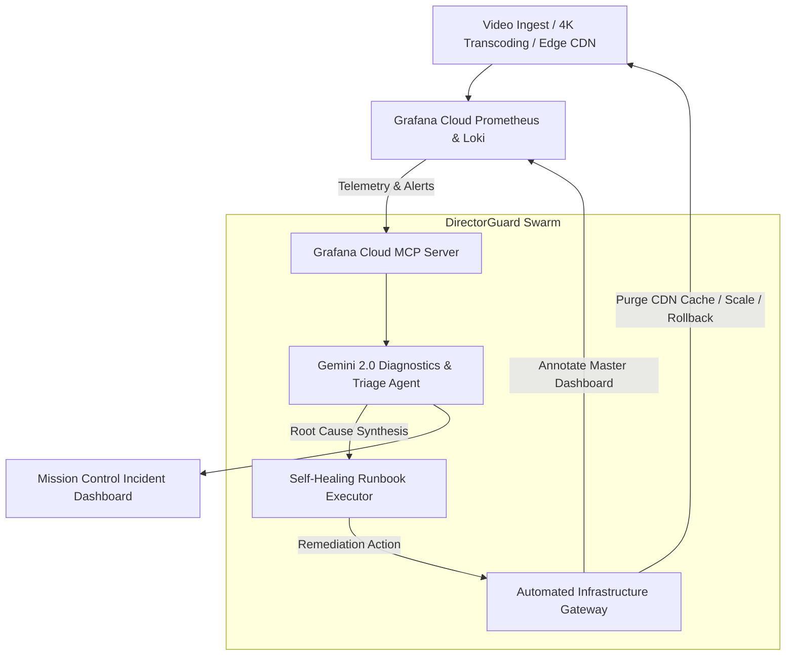

# 🎬 DirectorGuard.AI — Autonomous SRE & Media Streaming Incident Remediation Swarm

> **Agentic Cinema: The Blockbuster Hackathon Submission (Grafana Labs Track)**  
> *Autonomous AI-native SRE for Media, Entertainment & Live Streaming Infrastructure powered by Gemini 2.0 and Grafana Cloud MCP.*

---

## 🌟 Overview

In the era of 24/7 global video streaming, 4K HDR transcoding, and cloud broadcast pipelines, milliseconds of edge CDN lag or a transcoder worker crash can ruin a premiere for millions of viewers.

**DirectorGuard.AI** is an autonomous SRE & Incident Remediation swarm that connects **Gemini 2.0** directly to **Grafana Cloud** via the **Model Context Protocol (MCP)**. It monitors video pipelines, correlates Prometheus metrics with Loki log streams in real-time, diagnoses root causes, and automatically executes self-healing runbooks.

---

## 🏛️ Architecture



---

## 🚀 Key Features

1. **Grafana Cloud MCP Native Integration**:
   - Executes real-time `query_prometheus` (PromQL) and `query_loki` (LogQL) searches.
   - Automatically annotates Grafana dashboards (`annotate_dashboard`) when self-healing actions succeed.
2. **Deterministic Autonomous Runbooks**:
   - **CDN Cache Invalidation & Ingress Rerouting**: Resolves corrupted HLS manifests and 502 error spikes.
   - **Autoscaling & Canary Rollback**: Mitigates HEVC 4K transcoding memory leaks and pod eviction queues.
   - **Connection Pool Expansion & Circuit Breaking**: Protects DRM auth gateways from playback stalls.
3. **Cyberpunk-Cinema SRE Mission Control**:
   - Live Prometheus P99 latency visualizer with SLI breach limit lines.
   - Live Loki structured log terminal.
   - Chaos Injection Studio for simulated disaster injection and recovery testing.

---

## 🛠️ Tech Stack

- **AI Core**: Google Gemini 2.0 Agentic Architecture, Google Cloud Agent Development Kit (ADK)
- **Observability**: Grafana Cloud MCP Server (`mcp-grafana`), Prometheus (PromQL), Grafana Loki (LogQL), Grafana Dashboards
- **Backend**: Python 3.13, FastAPI, Uvicorn, Pydantic, Pytest
- **Frontend**: HTML5 Canvas, Vanilla CSS (Glassmorphism), ES6+ JavaScript

---

## 📦 Quickstart & Running Locally

### 1. Clone the Repository
```bash
git clone https://github.com/sundeep8967/directorguard-ai.git
cd directorguard-ai
```

### 2. Install Dependencies
```bash
pip install fastapi uvicorn pydantic requests pytest
```

### 3. Start the Mission Control Server
```bash
PYTHONPATH=backend python3 -m uvicorn main:app --host 127.0.0.1 --port 8899
```

### 4. Open in Browser
Visit: **`http://localhost:8899`**

---

## 🧪 Testing

```bash
PYTHONPATH=backend pytest tests/
```
